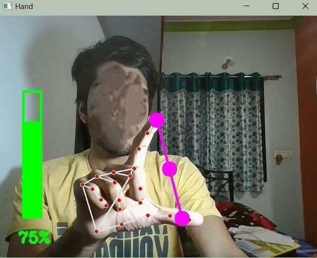
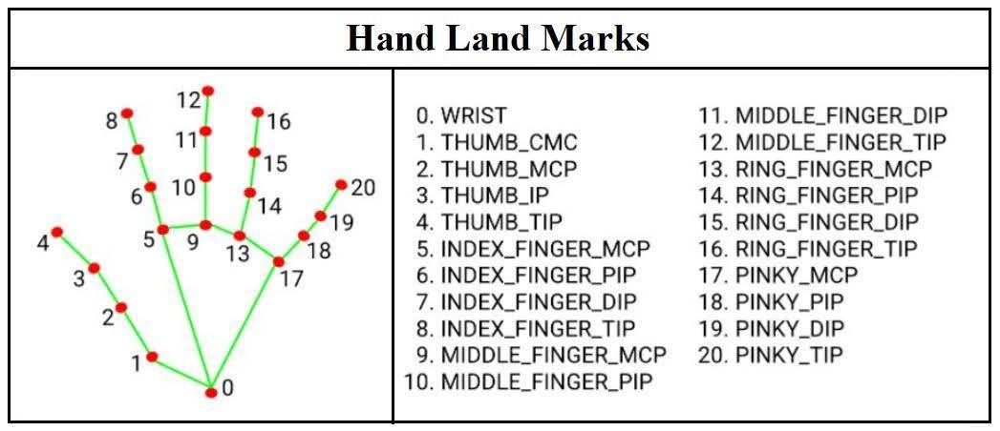
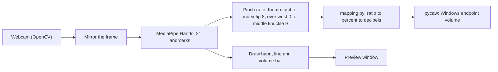
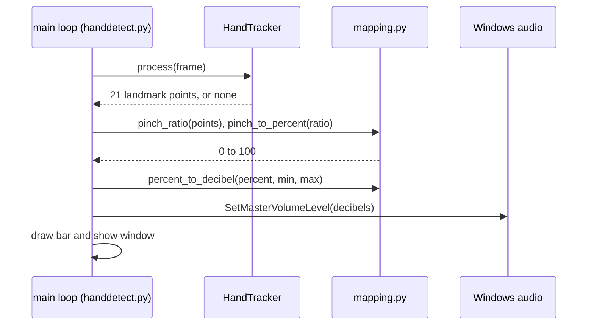

<h1 align="center">Hand Gesture Volume Control</h1>

<p align="center">
  Change your Windows volume by pinching your thumb and index finger in front of the webcam.<br>
  A live window draws the tracked hand and a volume bar while the system volume follows your fingers.
</p>

<p align="center">
  <a href="#try-it-live">Try it</a>
  &middot;
  <a href="#how-it-works">How it works</a>
  &middot;
  <a href="#run-it-locally">Run locally</a>
  &middot;
  <a href="#environment-variables">Settings</a>
</p>

<p align="center">
  
  
  
  
</p>

<p align="center">
  
</p>

<p align="center"><sub>Last updated: 2026-10-22 &middot; Runs locally on Windows (checked 2026-10-17); no hosted version, it needs your webcam and speakers</sub></p>

---

## Contents

- [About](#about)
- [Try it live](#try-it-live)
- [Features](#features)
- [Why it exists](#why-it-exists)
- [How it works](#how-it-works)
- [Engineering quality](#engineering-quality)
- [Run it locally](#run-it-locally)
- [Environment variables](#environment-variables)
- [Deployment](#deployment)
- [Status and roadmap](#status-and-roadmap)
- [Credits](#credits)

## About

Turning the volume up or down means reaching for a key or a slider, which is awkward when your hands
are busy or you sit back from the screen. This program reads your webcam, finds your hand, and sets
the master volume from how far apart your thumb and index finger are: pinched is 0%, spread is 100%.

It is a small desktop tool, not a service: everything runs on your own machine and no video leaves it.

## Try it live

Not deployed yet, and it cannot be: the program needs your webcam and your Windows speakers. Follow
[Run it locally](#run-it-locally) (about five minutes), then:

1. Run `python handdetect.py`; a window titled "Hand" opens with your camera feed.
2. Hold one hand in view. Dots and lines appear on it, with a magenta line between thumb tip and index tip.
3. Pinch and spread your fingers. The green bar and the percentage follow, and so does the Windows volume.
4. Press Esc to quit.

<table>
  <tr>
    <td width="50%"><p align="center"><sub>The preview window while running (<a href="#how-it-works">how it works</a>)</sub></p></td>
    <td width="50%"><p align="center"><sub>The 21 landmarks MediaPipe returns; the code uses 0, 4, 8 and 9 (<a href="#how-it-works">how it works</a>)</sub></p></td>
  </tr>
</table>

## Features

- **Pinch-to-volume**: the distance between thumb tip and index tip sets the master volume.
  - The distance is divided by your hand size (wrist to middle-finger knuckle), so sitting nearer or further from the camera does not change the result.
  - Linear between two ratios you can change (default 0.15 and 1.0); below the lower one the volume is 0%, above the upper one it is 100%.
- **Live feedback**: the window shows the tracked hand, the pinch line and a volume bar with a percentage.
- **Mirrored preview**: the image is flipped so moving your hand right moves it right on screen.
- **Tunable by environment variables**: camera index, pinch ratios, hands to track and detection confidence.
- **Clean exit**: Esc closes the window and releases the camera.

## Why it exists

A university project to try real-time computer vision: use a ready hand-landmark model for something
you can feel working straight away. It taught how to turn pixel coordinates into a control signal,
and how fast a Windows audio API changes between releases (see the pycaw note under *Design decisions*).

## How it works



What happens on each frame:



When no hand is in view the volume is left alone; it only changes while a hand is tracked.

### Tech stack

| Layer | Technology |
|---|---|
| Language | Python 3.12 (pinned in `mise.toml`) |
| Hand tracking | MediaPipe Hands 0.10.21 |
| Camera and drawing | OpenCV 4.11 |
| Volume control | pycaw and comtypes (Windows Core Audio) |
| Tests | pytest |
| Hosting | none, runs on your machine |

### Design decisions

1. **MediaPipe instead of a trained model.** A ready hand-landmark model gives 21 points per frame with no training. Trade-off: it depends on Google's package, and the `mp.solutions` API is why `mediapipe` is pinned to 0.10.21.
2. **Conversion kept in a pure module.** `mapping.py` has no camera or audio imports, so the ratio-to-decibels logic is unit-tested without hardware. Trade-off: one more file for two small functions.
3. **Windows volume is set in decibels, not percent.** The device reports its own decibel range, and the percentage is interpolated onto it, so 50% on screen is halfway in decibels. Trade-off: perceived loudness is not linear in decibels, so the middle can feel loud.
4. **Pinch measured against hand size, not pixels.** The same pinch is twice as many pixels at half the distance, so the distance is divided by the wrist to middle-knuckle length from the same frame. Trade-off: a hand turned edge-on shortens that reference in 2D and raises the ratio; MediaPipe's depth value is not used.
5. **pycaw current API.** Newer pycaw returns a device object with an `EndpointVolume` property; the old `Activate(...)` call fails with `AttributeError`. The code uses the new one, and `requirements.txt` pins pycaw so it stays that way.

<details>
<summary><strong>Project structure</strong></summary>

```
handdetect.py        webcam loop, hand tracking, drawing, volume call
mapping.py           pinch ratio (pinch over hand size) to percent to decibels (pure functions)
config.py            every setting, read from environment variables
tests/               unit tests for mapping.py
docs/images/         screenshots
mise.toml            Python version pin
requirements.txt     runtime dependencies, versions pinned
.env.example         every setting with a comment
```

</details>

## Engineering quality

| Area | What is in place |
|---|---|
| Tests | 17 pytest cases (2026-10-22): the ratio-to-volume conversion (clamping, linearity, device range), the same pose at four scales giving the same volume, a zero hand size, and config validation; none need a webcam |
| Startup check | on 2026-10-17 the app opened the camera and the speaker endpoint and ran 10 seconds without error on Windows 11 |
| Configuration | every value from environment variables with a clear error for a bad one; no secrets are involved |
| Not covered | the hand tracking itself and the live volume change are checked by hand, not by tests, and the hand-size change (2026-10-22) has not been run on a webcam; there is no CI |

Run the tests:

```bash
pip install -r requirements-dev.txt
python -m pytest
```

## Run it locally

Windows 10 or 11 only (pycaw uses Windows Core Audio), with a webcam. You need **Python 3.12**
(`mise.toml` pins it; [mise](https://mise.jdx.dev) installs and selects it, or install Python 3.12 yourself).
MediaPipe 0.10.21 has no wheels for newer Python releases.

```bash
git clone https://github.com/A-RYAN-1/hand-gesture-volume-control.git
cd hand-gesture-volume-control
mise install                      # installs the pinned Python 3.12
mise exec -- python -m venv .venv
source .venv/Scripts/activate     # Git Bash; in PowerShell: .venv\Scripts\Activate.ps1
pip install -r requirements.txt
python handdetect.py
```

Turn the system volume to a middle level first and keep it audible: the program takes it over as
soon as it sees a hand.

<details>
<summary><strong>Common problems</strong></summary>

- `AttributeError: 'AudioDevice' object has no attribute 'Activate'`: you are running an old copy of the script against a new pycaw; use this repository's `handdetect.py`.
- `Cannot open camera 0; set the CAMERA_INDEX environment variable`: another program holds the camera, or the camera is not index 0; close the other program or set `CAMERA_INDEX=1`.
- `No matching distribution found for mediapipe==0.10.21`: your Python is newer than 3.12; use the pinned version.
- You cannot reach 100%, or 0% is hard to hit: lower `PINCH_MAX_RATIO` or raise `PINCH_MIN_RATIO`; the defaults are first estimates.

</details>

## Environment variables

All optional. Copy `.env.example` for the list; the program reads the process environment, so export
the ones you change (for example `export CAMERA_INDEX=1` in Git Bash before running).

| Variable | What it is | Default |
|---|---|---|
| `CAMERA_INDEX` | which camera to open | `0` |
| `PINCH_MIN_RATIO` | thumb-to-index distance as a fraction of hand size meaning 0% | `0.15` |
| `PINCH_MAX_RATIO` | thumb-to-index distance as a fraction of hand size meaning 100% | `1.0` |
| `MAX_HANDS` | hands to look for (the first one controls the volume) | `1` |
| `DETECTION_CONFIDENCE` | MediaPipe detection threshold, 0 to 1 | `0.5` |

No secrets are used. Never commit a real `.env` file; only `.env.example` is tracked.

## Deployment

Not deployed yet, by design: it controls the speakers and camera of the machine it runs on, so there
is nothing to host. The realistic "release" is this repository run locally.

## Status and roadmap

**Reached:** runs locally on Windows 11 (checked 2026-10-17): camera opens, speaker endpoint found,
10-second run clean, 6 unit tests pass.

**Known limitations**

- Windows only.
- Tested by hand with one hand and one camera; the pinch is relative to hand size, but a hand turned edge-on to the camera reads as a wider pinch, and the 0.15 and 1.0 defaults have not been tuned on a live webcam.
- The first hand MediaPipe reports controls the volume, left or right.
- No CI.

**Planned**

- [ ] Smooth the volume to remove jitter.
- [ ] A key to lock the volume while the hand moves away.

## Credits

Built by [Aryan Deshmukh](https://github.com/A-RYAN-1) as a university project (2024); the baseline
(settings, tests, current pycaw API, this README) was done in October 2026.
