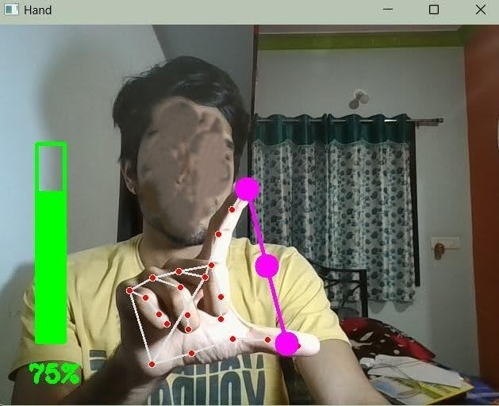
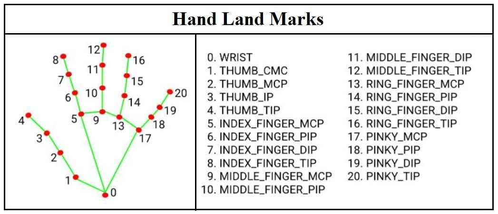
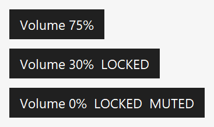
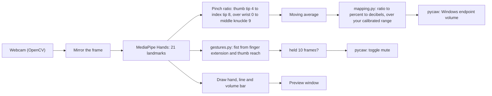
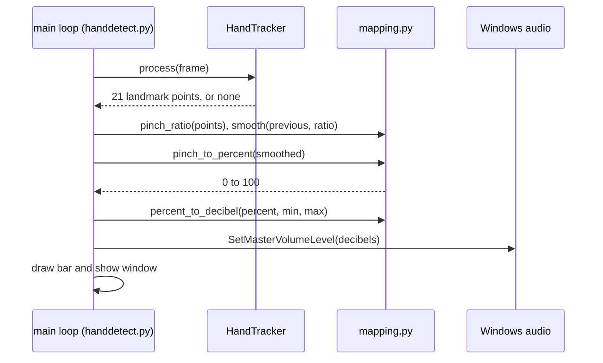

<h1 align="center">Hand Gesture Volume Control</h1>

<p align="center">
  Change your Windows volume by pinching your thumb and index finger in front of the webcam.<br>
  A live window draws the tracked hand and a volume bar while the system volume follows your fingers;<br>
  hold a fist to mute, and calibrate the range to your own hand in five seconds.
</p>

<p align="center">
  <a href="#try-it-live">Try it</a>
  &middot;
  <a href="#how-it-works">How it works</a>
  &middot;
  <a href="#run-it-locally">Run locally</a>
  &middot;
  <a href="#environment-variables">Settings</a>
</p>

<p align="center">
  
  
  
  
</p>

<p align="center">
  
</p>

<p align="center"><sub>Last updated: 2026-11-14 &middot; Runs locally on Windows (checked 2026-10-17); no hosted version, it needs your webcam and speakers</sub></p>

---

## Contents

- [About](#about)
- [Try it live](#try-it-live)
- [Features](#features)
- [Why it exists](#why-it-exists)
- [How it works](#how-it-works)
- [Engineering quality](#engineering-quality)
- [Run it locally](#run-it-locally)
- [Environment variables](#environment-variables)
- [Deployment](#deployment)
- [Status and roadmap](#status-and-roadmap)
- [Credits](#credits)

## About

Turning the volume up or down means reaching for a key or a slider, which is awkward when your hands
are busy or you sit back from the screen. This program reads your webcam, finds your hand, and sets
the master volume from how far apart your thumb and index finger are: pinched is 0%, spread is 100%.

It is a small desktop tool, not a service: everything runs on your own machine and no video leaves it.

## Try it live

Not deployed yet, and it cannot be: the program needs your webcam and your Windows speakers. Follow
[Run it locally](#run-it-locally) (about five minutes), then:

1. Run `python handdetect.py`; a window titled "Hand" opens with your camera feed.
2. Hold one hand in view. Dots and lines appear on it, with a magenta line between thumb tip and index tip.
3. Pinch and spread your fingers. The green bar and the percentage follow, and so does the Windows volume.
4. Press `C` and open and close the pinch fully for five seconds: your own range is saved and used from now on.
5. Close your hand into a fist and hold it for a moment: the volume mutes and the window shows MUTED. Hold a fist again to unmute.
6. Press Esc to quit.
7. For daily use, run `python handdetect.py --background`: no window opens, a small indicator in the bottom-right corner shows the volume for two seconds after it changes, and `Ctrl+Alt+L`, `Ctrl+Alt+C` and `Ctrl+Alt+Q` lock, calibrate and quit from any window. `python tools/startup.py install` starts it hidden at every Windows sign-in (`remove` undoes it).

<table>
  <tr>
    <td width="50%"><p align="center"><sub>The preview window while running (<a href="#how-it-works">how it works</a>)</sub></p></td>
    <td width="50%"><p align="center"><sub>The 21 landmarks MediaPipe returns; the code uses 0, 4, 8 and 9 (<a href="#how-it-works">how it works</a>)</sub></p></td>
  </tr>
  <tr>
    <td colspan="2"><p align="center"><sub>Background mode: the indicator that replaces the preview window, captured 2026-11-14 (<a href="#features">features</a>)</sub></p></td>
  </tr>
</table>

## Features

- **Pinch-to-volume**: the distance between thumb tip and index tip sets the master volume.
  - The distance is divided by your hand size (wrist to middle-finger knuckle), so sitting nearer or further from the camera does not change the result.
  - Linear between two ratios you can change (default 0.15 and 1.0); below the lower one the volume is 0%, above the upper one it is 100%.
- **Smoothed volume**: the pinch ratio goes through an exponential moving average (weight `SMOOTHING_ALPHA`, default 0.4), so landmark jitter does not shake the volume; the average restarts when the hand leaves the frame.
- **Volume lock**: press `L` (change with `LOCK_KEY`) with the preview window focused to freeze the volume at its current value, so you can lower your hand during a call or a film; the window shows LOCKED and the hand is still drawn. Press the key again to follow your pinch again.
- **Calibration to your hand**: press `C` (change with `CALIBRATE_KEY`) and open and close the pinch for 5 seconds; the 5th and 95th percentiles of your pinch become 0% and 100%, so a small hand or a stiff thumb still reaches both ends. Saved to `~/.hand-gesture-volume-control/calibration.json` (`CALIBRATION_FILE`) and loaded at start; refused with a reason when fewer than 30 frames had a hand or the pinch barely moved.
- **Fist to mute**: a fist held for 10 frames (about a third of a second, `MUTE_HOLD_FRAMES`) toggles mute once; release it before it can toggle again. While a fist is forming the volume holds still, so closing the hand does not first drag the volume to 0. Measured on 3,223 held-out hands: precision 0.934, recall 0.785 (see *Engineering quality*).
- **Background mode** (`--background` or `BACKGROUND=1`): no preview window; a small always-on-top box in the bottom-right corner shows the volume, LOCKED and MUTED for `INDICATOR_SECONDS` after any change and hides itself. `Ctrl+Alt` plus the lock key, the calibrate key or `QUIT_KEY` (default `q`) work from any window; only those three keys and the two modifiers are ever read. `python tools/startup.py install|remove|status` manages a hidden script in the Windows Startup folder. The camera stays on while it runs.
- **Live feedback**: the window shows the tracked hand, the pinch line and a volume bar with a percentage.
- **Mirrored preview**: the image is flipped so moving your hand right moves it right on screen.
- **Tunable by environment variables**: camera index, pinch ratios, lock and calibration keys, fist thresholds and hold, hands to track and detection confidence.
- **Clean exit**: Esc closes the window and releases the camera.

## Why it exists

A university project to try real-time computer vision: use a ready hand-landmark model for something
you can feel working straight away. It taught how to turn pixel coordinates into a control signal,
and how fast a Windows audio API changes between releases (see the pycaw note under *Design decisions*).

## How it works



What happens on each frame:



When no hand is in view the volume is left alone; it only changes while a hand is tracked and no fist is forming.

### Tech stack

| Layer | Technology |
|---|---|
| Language | Python 3.12 (pinned in `mise.toml`) |
| Hand tracking | MediaPipe Hands 0.10.21 |
| Camera and drawing | OpenCV 4.11 |
| Volume control | pycaw and comtypes (Windows Core Audio) |
| Tests | pytest |
| Hosting | none, runs on your machine |

### Design decisions

1. **MediaPipe instead of a trained model.** A ready hand-landmark model gives 21 points per frame with no training. Trade-off: it depends on Google's package, and the `mp.solutions` API is why `mediapipe` is pinned to 0.10.21.
2. **Conversion kept in a pure module.** `mapping.py` has no camera or audio imports, so the ratio-to-decibels logic is unit-tested without hardware. Trade-off: one more file for two small functions.
3. **Windows volume is set in decibels, not percent.** The device reports its own decibel range, and the percentage is interpolated onto it, so 50% on screen is halfway in decibels. Trade-off: perceived loudness is not linear in decibels, so the middle can feel loud.
4. **Pinch measured against hand size, not pixels.** The same pinch is twice as many pixels at half the distance, so the distance is divided by the wrist to middle-knuckle length from the same frame. Trade-off: a hand turned edge-on shortens that reference in 2D and raises the ratio; MediaPipe's depth value is not used.
5. **Moving average, not a filter library.** One line of arithmetic, one setting. Trade-off: lag grows as the weight falls; at 0.4 a step reaches 90% in 5 frames. A median or Kalman filter would cost more code for a small tool.
6. **A fist from two measured ratios, not a trained network.** For each of the four fingers, the wrist-to-tip distance over the wrist-to-middle-joint distance (a curled finger drops to about 1 or below), and the thumb tip's distance from the middle knuckle over the hand size (a thumbs-up reaches far). Both thresholds are fitted by grid search on one split of HaGRID's recorded hands, maximising F0.5 so precision counts twice as much as recall (an unwanted mute is worse than a second try), and reported once on a held-out split. Trade-off: two numbers can be read and checked, but they miss fists seen from unusual angles (recall 0.785).
7. **Percentiles for calibration.** The 5th and 95th percentiles of the recorded pinch, not the minimum and maximum, so one wrong landmark frame does not stretch the range. Trade-off: the extreme 5% at each end clamps to 0% and 100%.
8. **pycaw current API.** Newer pycaw returns a device object with an `EndpointVolume` property; the old `Activate(...)` call fails with `AttributeError`. The code uses the new one, and `requirements.txt` pins pycaw so it stays that way.

<details>
<summary><strong>Project structure</strong></summary>

```
handdetect.py        webcam loop, hand tracking, drawing, volume call
tools/measure_jitter.py jitter and lag before and after smoothing, on synthetic noise
tools/fit_fist.py    fits the two fist thresholds on data/hagrid-fit.json.gz
tools/evaluate_gestures.py  fist precision and recall on held-out hands, or on your own recording
tools/record_landmarks.py   records your own labelled hands (landmarks only, never a picture)
tools/build_hagrid_set.py   rebuilds data/ from the HaGRID annotation files
mapping.py           pinch ratio (pinch over hand size) to percent to decibels (pure functions)
gestures.py          fist features, the fist test and the hold-frames guardrail (pure)
calibration.py       per-user range from percentiles, the saved profile (pure)
lock.py              the volume lock (pure)
data/                recorded HaGRID hands, labels and landmarks only (CC BY-SA 4.0, see data/README.md)
config.py            every setting, read from environment variables
tests/               unit tests for every pure module and the classifier's held-out floor
.github/workflows/   CI: tests, the fit and the held-out evaluation
docs/images/         screenshots
mise.toml            Python version pin
requirements.txt     runtime dependencies, versions pinned
.env.example         every setting with a comment
```

</details>

## Engineering quality

| Area | What is in place |
|---|---|
| Tests | 75 pytest cases in CI on every pull request (2026-11-12): the ratio-to-volume conversion, scale invariance, smoothing, the lock, calibration percentiles and refusals, the saved profile, the fist features against thumbs-up and one-finger look-alikes, the hold and release rule, and config validation; none need a webcam |
| Fist classifier | fitted on HaGRID's `ann_subsample` hands (2,482, of which 96 fists) and reported on a held-out sample of `ann_test` (3,223 hands from photos not in the fit set, 144 fists), 2026-11-12 in CI: **precision 0.934, recall 0.785** (113 found, 8 false, 31 missed). Other hands taken for a fist: thumbs-down 2.0%, thumbs-up 1.4%, pointing 0.7%, hands at rest (`no_gesture`, 540) 0.4%, every other gesture 0%. A CI test fails if precision drops below 0.90, recall below 0.75 or the resting rate above 2% |
| Jitter | `python tools/measure_jitter.py` on a synthetic held pinch with Gaussian landmark noise (3000 frames, seed 7, 2026-10-22): jitter 3.50 volume points with smoothing off, 1.79 at the default (49% lower); a step to 100% reaches 90% after 1 frame off, 5 frames at the default. Synthetic, not measured on a webcam |
| Background run | on 2026-11-14, on Windows 11 with a real webcam, `--background` ran 8 seconds with no "Hand" window and `Ctrl+Alt+Q` (sent by a script) ended it in 0.4 seconds with exit code 0; the indicator window was checked on its own (bottom-right, always on top, shows and hides); `tools/startup.py` install, status and remove were run once. No sign-in restart was done and no hand was in view, so volume changes in background mode are not checked live |
| Startup check | on 2026-10-17 the app opened the camera and the speaker endpoint and ran 10 seconds without error on Windows 11 |
| Configuration | every value from environment variables with a clear error for a bad one; no secrets are involved |
| Not covered | the hand tracking, the live volume change, calibration and mute on a real webcam are not checked yet; the classifier's numbers come from photos, not webcam video |

Run the tests:

```bash
pip install -r requirements-dev.txt
python -m pytest
```

## Run it locally

Windows 10 or 11 only (pycaw uses Windows Core Audio), with a webcam. You need **Python 3.12**
(`mise.toml` pins it; [mise](https://mise.jdx.dev) installs and selects it, or install Python 3.12 yourself).
MediaPipe 0.10.21 has no wheels for newer Python releases.

```bash
git clone https://github.com/A-RYAN-1/hand-gesture-volume-control.git
cd hand-gesture-volume-control
mise install                      # installs the pinned Python 3.12
mise exec -- python -m venv .venv
source .venv/Scripts/activate     # Git Bash; in PowerShell: .venv\Scripts\Activate.ps1
pip install -r requirements.txt
python handdetect.py
```

Turn the system volume to a middle level first and keep it audible: the program takes it over as
soon as it sees a hand.

<details>
<summary><strong>Common problems</strong></summary>

- `AttributeError: 'AudioDevice' object has no attribute 'Activate'`: you are running an old copy of the script against a new pycaw; use this repository's `handdetect.py`.
- `Cannot open camera 0; set the CAMERA_INDEX environment variable`: another program holds the camera, or the camera is not index 0; close the other program or set `CAMERA_INDEX=1`.
- `No matching distribution found for mediapipe==0.10.21`: your Python is newer than 3.12; use the pinned version.
- You cannot reach 100%, or 0% is hard to hit: press `C` to calibrate to your hand (or set `PINCH_MAX_RATIO` and `PINCH_MIN_RATIO`).
- The volume mutes when you did not mean it: raise `MUTE_HOLD_FRAMES`, or lower `FIST_MAX_EXTENSION`; record your own hands with `tools/record_landmarks.py` and check them with `tools/evaluate_gestures.py <file>`.

</details>

## Environment variables

All optional. Copy `.env.example` for the list; the program reads the process environment, so export
the ones you change (for example `export CAMERA_INDEX=1` in Git Bash before running).

| Variable | What it is | Default |
|---|---|---|
| `CAMERA_INDEX` | which camera to open | `0` |
| `PINCH_MIN_RATIO` | thumb-to-index distance as a fraction of hand size meaning 0% (a calibration replaces it) | `0.15` |
| `PINCH_MAX_RATIO` | thumb-to-index distance as a fraction of hand size meaning 100% | `1.0` |
| `SMOOTHING_ALPHA` | weight of the newest frame in the smoothed pinch, above 0 to 1 (1 is off) | `0.4` |
| `LOCK_KEY` | single letter or digit that locks and unlocks the volume | `l` |
| `CALIBRATE_KEY` | single letter or digit that starts a calibration (not the lock key) | `c` |
| `CALIBRATION_SECONDS` | how long a calibration records | `5` |
| `CALIBRATION_FILE` | where your calibrated range is saved and read at start | `~/.hand-gesture-volume-control/calibration.json` |
| `FIST_MAX_EXTENSION` | largest finger extension still counted as curled (fitted) | `0.77` |
| `FIST_MAX_THUMB_REACH` | furthest thumb reach still counted as tucked in (fitted) | `0.56` |
| `MUTE_HOLD_FRAMES` | frames in a row a fist must be held to toggle mute | `10` |
| `BACKGROUND` | `1` runs without the preview window (same as `--background`) | `0` |
| `QUIT_KEY` | letter or digit that quits in background mode with Ctrl+Alt (not the lock or calibrate key) | `q` |
| `INDICATOR_SECONDS` | how long the background indicator stays after a change | `2` |
| `MAX_HANDS` | hands to look for (the first one controls the volume) | `1` |
| `DETECTION_CONFIDENCE` | MediaPipe detection threshold, 0 to 1 | `0.5` |

No secrets are used. Never commit a real `.env` file; only `.env.example` is tracked.

## Deployment

Not deployed yet, by design: it controls the speakers and camera of the machine it runs on, so there
is nothing to host. The realistic "release" is this repository run locally.

## Status and roadmap

**Reached:** runs locally on Windows 11 (checked 2026-10-17): camera opens, speaker endpoint found,
10-second run clean, 6 unit tests pass.

**Known limitations**

- Windows only.
- Background mode started from the Startup folder has no console, so a start-up error (no camera, wrong camera index) shows nothing; run `python handdetect.py --background` once in a terminal to see it. Its CPU use was not measured.
- Tested by hand with one hand and one camera; the pinch is relative to hand size, but a hand turned edge-on to the camera reads as a wider pinch, and the 0.15 and 1.0 defaults have not been tuned on a live webcam.
- The first hand MediaPipe reports controls the volume, left or right.
- Smoothing is verified on synthetic noise only; the real jitter of your webcam and hand has not been measured.
- The fist classifier is measured on photos (HaGRID), whose image size is not recorded, so distance ratios carry the photo's aspect; false mutes per minute of webcam video are not measured. `tools/record_landmarks.py idle 60 me.jsonl` and `tools/evaluate_gestures.py me.jsonl` give that number for your own camera.
- About one fist in five is missed (recall 0.785); holding the fist square to the camera should help, which is not yet measured.

**Planned**

- [x] Background mode with an indicator, global hotkeys and a start-with-Windows option (2026-11-14).
- [ ] Measure false mutes per minute on a recorded webcam session.
- [ ] A second gesture for play and pause.

## Credits

Built by [Aryan Deshmukh](https://github.com/A-RYAN-1) as a university project (2024); the baseline
(settings, tests, current pycaw API, this README) was done in October 2026.
